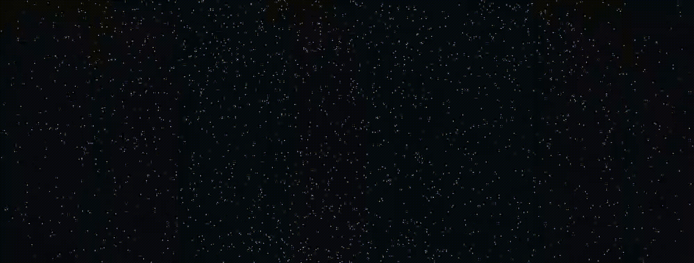

  <!-- 动态打字机效果标题 -->
  

  

    <b>☕ Java Artisan &nbsp;|&nbsp; 🦀 Rust Explorer &nbsp;|&nbsp; 🎮 Minecraft Modder</b> 
    <i>「手感铸就锋芒，连招谱写律动 —— 机制的美！」</i>
  

  <!-- 徽章走廊 -->
  

    
    
    
    
    
  

---

### 🗡️ 兵刃谱·我的常用语言 / Tech Arsenal

  | 领域 | 核心 | 态度 |
  | :--- | :--- | :--- |
  | **核心 (Primary)** | `Java` | 支柱 |
  | **后端 (Modern)** | `Rust` | - |
  | **脚本 (Versatile)** | `TypeScript` &nbsp;\|&nbsp; `C#` | 没事写写吧，主要是unity要用到 |
  | **IDE (Environment)** | `VS Code` &nbsp;\|&nbsp; `Gradle` &nbsp;\|&nbsp; `Git` | - |

   

  

---

### 📂 展开我的武器库 / Collapsible Showcase

<b>🔍 点击查看更多个人杂项与偏好 (Click to expand)</b>

 

- 🎯 **编码风格**：有些强类型洁癖
- 🎮 **喜爱的模组类型**：动作增强、机制拓展、沉浸式视效
- 🚫 **雷区**：无脑秒杀机制、粗制滥造的数值怪！说的就是你，秒杀圈！！！

---

### 🐾 闲语星尘 / Stardust Whisper

  

---

### 🌐 营地传送门 / Portal & Releases

  
  &nbsp;
  
  &nbsp;
  
  &nbsp;
  

    
  <i>Designed with 🐾 by Bai Ling (白凌) for Master RLlufee</i>

